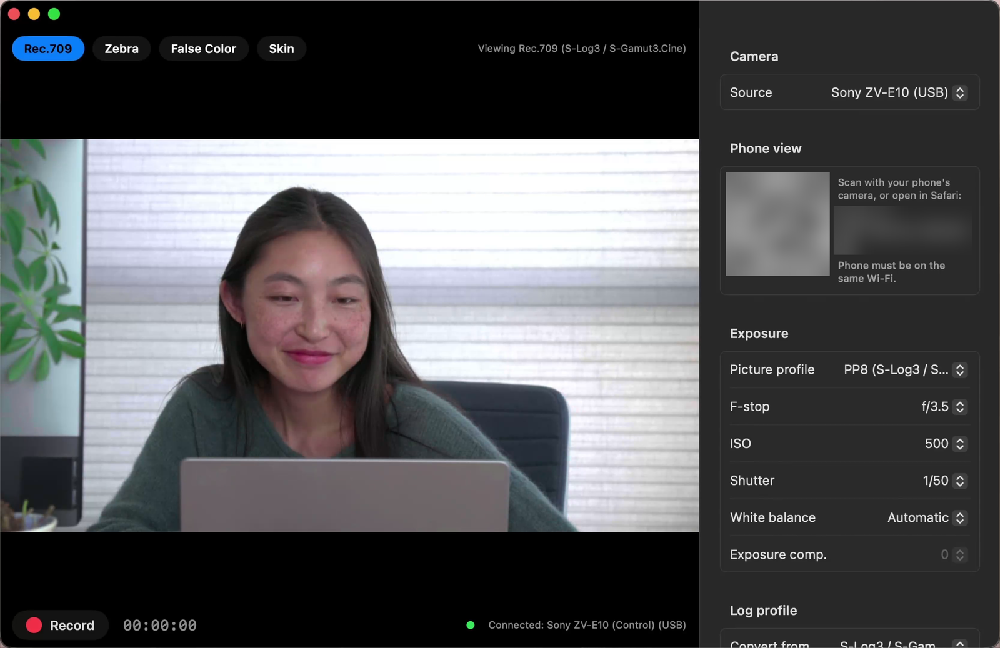

# Sony Log Monitor



A macOS field monitor for Sony cameras shooting S-Log. Plug the camera in over USB and see its live view converted to Rec.709, with zebras, false color and a skin-tone band, plus remote exposure control. The same picture is mirrored to your phone over Wi-Fi.

Tested on the **ZV-E10**. It should work with other Sony bodies that [libgphoto2](http://www.gphoto.org/proj/libgphoto2/support.php) supports in PC Remote mode, but they haven't been tested. Reports and PRs are welcome.

## Features

- **Live view** over USB, with a log ↔ Rec.709 toggle. Supports S-Log3 / S-Gamut3.Cine, S-Log3 / S-Gamut3 and S-Log2 / S-Gamut.
- **Exposure tools**, measured on the Rec.709 image: zebras (above a level, or a range), false color, and an adjustable skin-tone band. Keys: `L` Rec.709, `Z` zebra, `F` false color, `S` skin.
- **Camera control**: picture profile, F-stop, ISO, shutter, white balance, and record with a timer.
- **Follows the picture profile**: switching the camera to a log PP selects the matching curve and turns on the Rec.709 view.
- **Phone view**: scan the QR code in the sidebar to open the monitor in Safari and control it from there. It's for your local network only and has no authentication, so don't expose it to the internet.
- **Demo mode**: play an S-Log clip from disk, or use a built-in S-Log3 test chart, to try everything without a camera.

## Requirements

- macOS 13 or later on Apple silicon
- Xcode Command Line Tools (`xcode-select --install`)
- [Homebrew](https://brew.sh) and libgphoto2: `brew install gphoto2`

## Build and run

```sh
./build.sh          # builds .build/manual/Sony Log Monitor.app
./build.sh run      # builds and opens it
./build.sh check    # builds and runs the self-check (color math, and GPU vs CPU output)
```

The build calls `swiftc` and `clang` directly, so you don't need full Xcode.

## Connecting the camera

1. On the camera, set **USB Connection** (or USB Connection Mode) to **PC Remote**.
2. Plug it in over USB and launch the app. It connects automatically and reconnects if the cable is unplugged.
3. Quit Photos or Image Capture if either one is holding the camera. The app also stops macOS's `ptpcamerad`, which otherwise claims the camera as soon as it's plugged in.

## Notes on other Sony bodies

- **Picture profile mapping** (`Sources/SonyLogMonitor/Camera.swift`, `PictureProfile`) uses the ZV-E10's factory layout: PP7 = S-Log2, PP8 = S-Log3 / S-Gamut3.Cine, PP9 = S-Log3 / S-Gamut3. If your body numbers them differently, turn off "Follow camera picture profile" and choose the curve in the sidebar, or open a PR with your camera's mapping.
- **Sony's Camera Remote SDK** doesn't accept the original ZV-E10, which is why this app uses libgphoto2. `Tools/probe.cpp` (`./build.sh probe`) tests whether the SDK talks to your camera. To build it, [download the SDK from Sony](https://support.d-imaging.sony.co.jp/app/sdk/en/index.html) and put its headers in `Vendor/CrSDK/include` and its libraries in `Vendor/CrSDK/lib`. The SDK isn't included in this repo because its license doesn't allow redistribution.

## How it works

- `Sources/MonitorCore`: the color math (Sony's published S-Log curves and gamut matrices) and the exposure bands. The Metal shader is generated from these same constants, and `SelfCheck` checks the GPU output against a CPU copy of the math.
- `Sources/GPhotoBridge`: a small C wrapper around libgphoto2 (open, live view, get and set settings).
- `Sources/SonyLogMonitor`: the SwiftUI app, the Metal renderer, and the phone server (MJPEG stream and JSON state).

## License

MIT. libgphoto2 is LGPL-2.1 and is linked dynamically from Homebrew.
